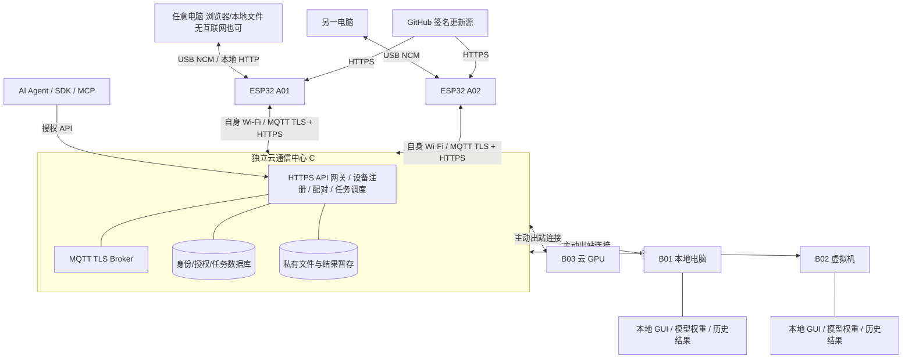
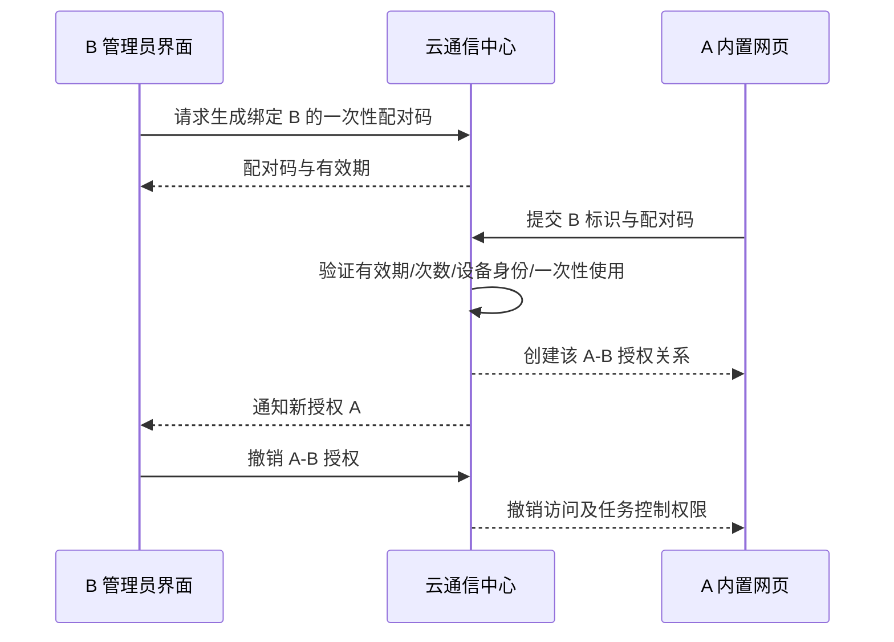
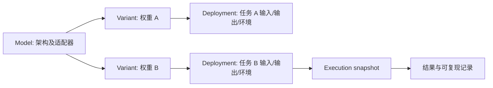
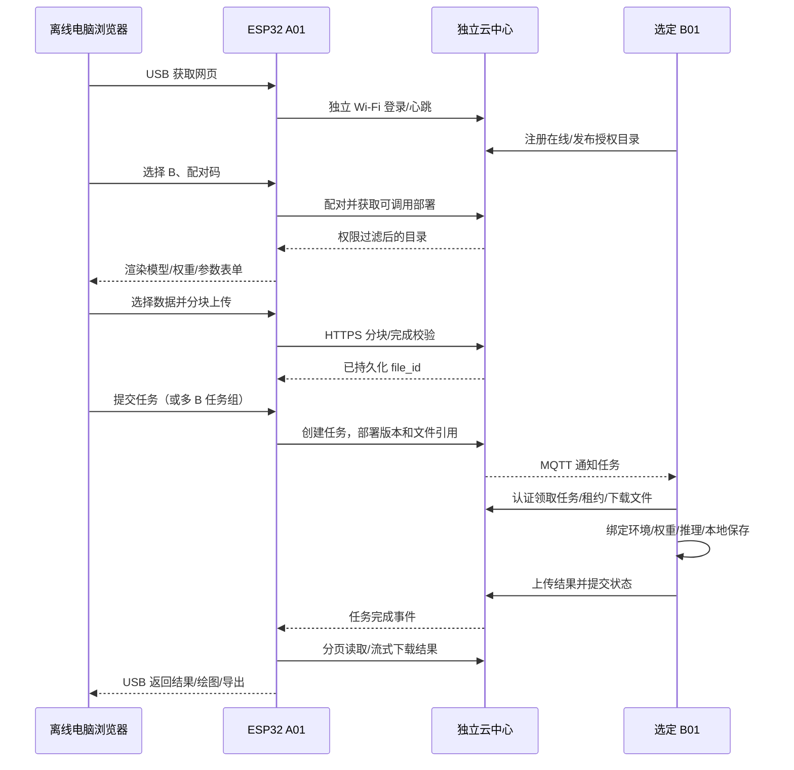
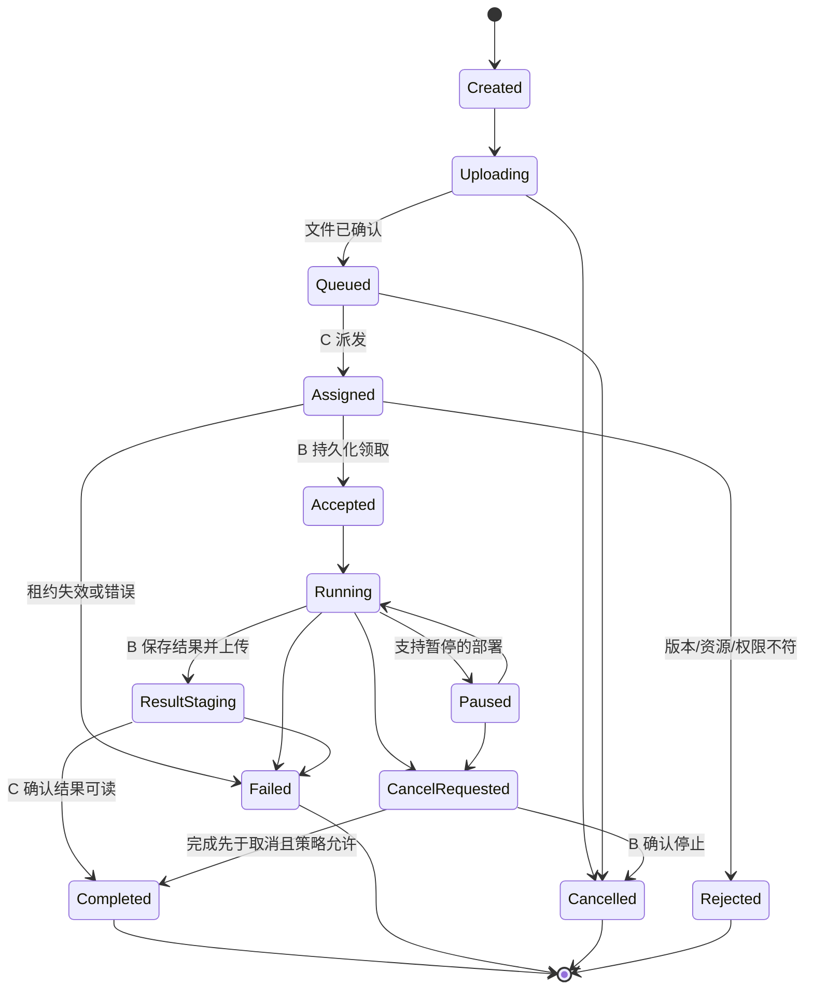

# 通用 A/B AI 边缘交互与计算平台 — Codex 完整开发总纲 V3.0

**性质：最终架构决策及端到端开发需求（2026-11-26）。** 本文取代此前 Battery System A/B 开发总纲；以本文件为唯一开发规格。项目名称暂沿用 `Battery_System_A` 仓库，不代表只面向电池。当前没有声称完成本次新增功能。本文件是开发与验收要求，不是已实现的软件或测试报告。

## 1. 目标、已确认决策和边界

### 1.1 用户已经确认的架构决策

| 决策 | 最终要求 |
|---|---|
| 通信中心 C | **独立云服务器**，不依赖任何一个 B 在线；A/B 主动连接 C |
| B 的运行模式 | **本地独立运行 + 远程服务同时支持**，本地功能不能因 C 断线失效 |
| 设备授权 | **逐设备、逐对 A/B 配对授权，可撤销**；独立凭证，不共用全局密码 |
| A | ESP32-S3 N16R8；只通过 USB 数据线使用电脑浏览器，全部前端资源存于板上 Flash |
| A 与电脑 | 电脑可以完全无互联网；USB NCM 本地网页可访问；不可将 A 变成电脑互联网网关 |
| A 与 B | 多对多；A 可选择任意多个已授权 B，B 可管理/允许多个 A；互不串任务、数据及结果 |
| B | 可移动的软件包，在 Windows/Linux、虚拟机或云电脑运行；自动/手动选择已有 Python/Conda/PyTorch 环境 |
| 模型 | 任意任务类型，多个模型、每模型多权重、每权重可对应不同温度/数据集/任务；复用已训练权重，默认只推理不训练 |
| 数据 | A 选择所插电脑的本地文件；B 也能本机独立选择文件；远程结果返回 A，同时 B 本地保存，双方可视化/导出 |
| AI 扩展 | A/B/C 提供版本化 API；可选 Python SDK 和 MCP 适配，便于 AI Agent 调用 |
| 更新 | GitHub 独立 UI 更新、OTA 固件升级、签名和回退；尽量只需首次 COM 烧录，保留救援方式 |

### 1.2 通用化约束

- 不将 SOC、SOH、V/I/T、四个固定特征或任何特定 CSV 列写死在平台内核；电池研究是首批插件示例。上传的 `GUI用于验证.rar` 仅为便携推理 GUI 的示范，不是输入契约，不要求复刻其模型、字段或 UI。真实 SOC/SOH 研究已完成训练；用户提供所选模型结构、权重和预处理后直接接入推理。不得未经确认训练、改权重或推测实际输入。
- 第一版不增加任何硬件：不接传感器、SD 卡、屏幕。A 不承担大模型计算，不长期存储大文件；电脑浏览器显示 UI，B 负责实际执行。
- A、B 都能看见经授权的对端；B 端选择允许哪些 A 提交任务、是否暂停远程接单，及向 A 发送授权的结果/状态/任务邀请。第一版任务执行目标为 B，A 的任务是文件选择、转发、展示、设备管理；B 不得借授权任意读取插入 A 的电脑或远程执行主机命令。若以后要让 A 本地计算，新增明确能力和授权。
- A 不固定绑定 B 的 IP、硬件或操作系统；只要 B 在 C 上在线、已授权、目标模型可用且有资源，就可被调用。迁移同一 B 身份需明确移交凭据、关闭旧实例；复制出新节点必须生成不同身份。
- 用户日常操作不应要求下载 ZIP、解压、反复编译、物理拔插。研发期可以必要时分步烧录验证；正式版优先签名远程更新。不能保证 USB 底层失效仍能 OTA。

### 1.3 最终拓扑（控制面与数据面分离）



C 的控制面记录身份、授权、目录、任务状态并转发通知；数据面提供有界、私有、授权的 HTTPS 文件中转。C 不运行用户模型、不保存权重（除用户将来另行授权的模型发布功能），不自动公开 B 的文件。B 不必拥有公网 IP，A 也不需要 B 实际 IP；最终架构不把 C 部署在 B 上。本地开发允许模拟 C，但不算实际云部署验收。

### 1.4 文档阅读方式

第 2–6 节保存已验证的环境、接管方式及 OTA 设计；第 7–17 节规定全新通用平台的功能、协议、安全、交付和验收。新要求以本文件为准。路径、已实测进度来自此前实际操作；未给出的云地址、凭据、模型参数均需现场确认。技术栈、配额和 API 路径为可执行默认设计，可在记录 ADR（架构决策记录）后调整，但不能改变用户已确定的三项核心架构。

## 2. 已确认的环境与实际进度

| 项目 | 已知信息 |
|---|---|
| 开发电脑 | Windows 10 21H1，19043.1826，Anaconda PowerShell Prompt |
| 主控 | ESP32-S3 N16R8，16 MB Flash、8 MB PSRAM（规格；PSRAM 尚未确认启用） |
| Python | `F:\Anaconda\python.exe`，3.11.4；Conda base；另有研究环境（如 `torch_env`，实际检查），不要破坏 |
| ESP-IDF | `F:\Espressif\esp-idf\esp-idf-v5.5.6` |
| 工具链 | `F:\Espressif\tools`（IDF_TOOLS_PATH） |
| 当前固件工程 | `F:\ESP32_Projects\Battery_System_A` |
| 当前主源文件 | `main\tusb_ncm_main.c` |
| 当前工程来源 | ESP-IDF 官方 `examples\peripherals\usb\device\tusb_ncm` 的独立副本，后续改为 USB 本地 Web 服务 |
| 备份 | 工程中此前建立过 `main_backup`；请实际检查，不假定完整 |
| GitHub | https://github.com/jimjury/Battery_System_A ，公开仓库，main 分支 |
| 计划同步目录 | `F:\ESP32_Projects\Battery_A_Update`，上一步刚给出克隆命令，尚未确认执行 |
| USB COM 口 | COM12（用于烧录/日志；每次确认实际端口） |
| 原生 USB 口 | 标注 USB 的 Type-C（NCM 网卡、网页访问）；另一个标注 COM |
| USB Windows 驱动 | 已手动安装 Microsoft `UsbNcm Host Device`，版本 10.0.19041.1 |
| USB 网卡名称 | `以太网 2`（实际操作前再次确认） |
| ESP32 USB 地址 | `192.168.7.1/24` |
| 电脑 USB 地址 | `192.168.7.2/24`，静态 IP，无默认网关 |

已由用户实际截图确认：ESP-IDF 安装、工具链激活、固件编译烧录、TinyUSB NCM 驱动初始化、Windows 网卡识别、静态 IP 通信（ping 0% 丢包、0–1 ms）、curl 返回内置 HTML、浏览器成功打开 Battery System A 测试页。

原始官方桥接示例曾连上 Wi-Fi，但当前独立 USB 网页固件暂时关闭 Wi-Fi；不能据此认为现有固件已经联网。电脑 WLAN 完全断开后的专门验证曾被用户跳过，作为后续验收项补做，不要因此卡住当前开发。

曾出现的问题及处理：
- EIM 图形安装器 PATH/PowerShell 脚本报错：已绕过安装器，使用官方完整压缩包和 `install.ps1 esp32s3` 成功安装；不要再走 EIM 或安装第二套 Python。
- `idf.py --version` 返回 `v1.0.3` 是命令包装器路径优先；直接调用 IDF 的 Python 脚本得到 `ESP-IDF v5.5.6-dirty`，后续统一显式调用该脚本。
- USB 网卡自动得到 `169.254.x.x` 导致访问失败：当前固件没有 DHCP，设置静态 IP 后成功。不需要替换已工作的 NCM 方案。
- 当前 16 MB Flash 配置已经编译成功，但原始 factory app 分区只有 1 MB。要做 OTA 和独立网页存储，必须重新规划分区。
- 电脑 C 盘空间曾明显减少，具体原因未查清；新工具和构建尽量放 F 盘，避免重复下载和不必要的缓存；不要擅自清理 C 盘。

### GitHub 上已经存在的文件

```text
README.md
updates/manifest.json
bootstrap/battery_wifi.c
bootstrap/setup.html
```

`manifest.json` 初始内容：`{"schema_version":1,"target":"esp32s3","ui":null,"firmware":null}`。当前没有可用更新。`bootstrap` 中是上一轮写入的 Wi-Fi 扫描/连接、NVS 保存、状态查询、NTP、GitHub HTTPS 清单检测以及嵌入式配网页源码，**尚未合并到本地工程、未经过实体编译及测试**。它们是待审查的草稿，不能直接当作完成品；需要检查 ESP-IDF 5.5.6 的 API、头文件、Wi-Fi 状态切换、重连并发、TLS 时间同步、超时、错误处理、HTTP 权限和内存安全。

另曾提供 `Battery_System_A_UI_v0.2.zip`（包含 index.html、apply_ui.py、README.txt），是单独的网页原型：支持本地 CSV/TXT 预览和曲线，其他服务功能有预留。用户没有确认已下载/应用/烧录。如果本地能找到，可审查并复用；找不到就从现有需求实现，不依赖该 ZIP，也不要盲目运行旧补丁脚本覆盖工程。

## 3. 立即执行：同步仓库与检查本地环境

在现有 Anaconda PowerShell 中执行（Codex 应自行检查目录存在性并适配）：

```powershell
$ErrorActionPreference = 'Stop'
$root = 'F:\ESP32_Projects'
$repo = Join-Path $root 'Battery_A_Update'
Set-Location $root
if (Test-Path (Join-Path $repo '.git')) {
    git -C $repo status --short
    # 确认 origin 正确、工作树无冲突后执行：
    git -C $repo pull --ff-only
} elseif (-not (Test-Path $repo)) {
    git clone https://github.com/jimjury/Battery_System_A.git Battery_A_Update
} else {
    throw '目标目录已存在但不是 Git 仓库，先检查并保护其中的文件。'
}
Get-ChildItem (Join-Path $repo 'bootstrap')
```

如果 `git pull` 失败，不要强制覆盖用户文件。确认远端权限；使用 Git Credential Manager、GitHub CLI 已登录状态或用户明确授权的方式，不要要求用户把 token 粘贴到公开代码或聊天。

激活既有工具链：

```powershell
$env:IDF_TOOLS_PATH = 'F:\Espressif\tools'
Set-ExecutionPolicy -Scope Process Bypass -Force
Set-Location 'F:\Espressif\esp-idf\esp-idf-v5.5.6'
.\export.ps1
Set-Location 'F:\ESP32_Projects\Battery_System_A'
python "$env:IDF_PATH\tools\idf.py" --version
```

先检查项目的实际 `CMakeLists.txt`、`main/CMakeLists.txt`、`main/idf_component.yml`、`sdkconfig`、`sdkconfig.defaults`、`dependencies.lock`、源文件、Git 状态、端口及 USB 网卡，并保存一份带时间戳的可恢复本地备份（包括源代码、分区配置和当前可用固件二进制）。备份可能包含敏感信息，不上传 GitHub。

记录当前 baseline 版本、已有构建产物、分区表和联网状态，先用现有工程进行一次 baseline build，确认能够复现。

## 4. 统一代码管理与一键工具

当前工程目录与 GitHub 同步目录是两个不同目录，后续应消除手工复制、反复下载 ZIP 的工作流。先选定一个唯一可编辑的源代码根目录（建议保留现有工程路径，在其内对接已创建的仓库，或由已同步仓库作为唯一开发根目录；如需移动项目，先备份并记录新路径）。不要盲目覆盖/强制推送，不要留下两套互相覆盖的可写源码。

推荐最终仓库组织（可按实际工程调整）：

```text
Battery_System_A/
  firmware/              # ESP-IDF 工程及可复现配置
  web/                   # A 的 HTML/CSS/JS，离线资源
  server_b/              # B 便携应用、GUI、执行器、模型适配器
  control_center/        # 独立云通信中心、注册、授权、调度、文件服务
  sdk/                   # Python SDK、MCP 适配器
  protocol/              # 通信协议和消息格式
  updates/manifest.json  # 已验证发布的签名更新清单
  scripts/               # 环境激活、构建、发布、USB部署、测试
  tests/                 # 单元、集成、回归测试
  docs/                  # 使用说明、验收记录、故障恢复
  .github/workflows/      # 可选：自动构建及发布
  .gitignore
  README.md
```

公开仓库只提交经过检查的源码、锁定依赖、必要的默认配置和可公开构建产物。排除 `sdkconfig`（可能含旧 Wi-Fi 密码）、`sdkconfig.old`、备份、私有模型/数据、日志、`.env`、NVS 镜像、签名私钥、令牌及整个 `build/`/工具链目录。必要的非敏感配置以 `sdkconfig.defaults` 或模板文件形式提交。扫描敏感信息后再 push。

提供一键 PowerShell 脚本：`build.ps1`、`flash_usb.ps1`、`monitor.ps1`、`publish_ui.ps1`、`publish_firmware.ps1`、`test.ps1`；负责自动激活上述环境、检查退出码、记录版本和日志。刷写命令默认显式传入 COM12，实际变更时可指定参数。构建失败严禁继续刷写。GitHub Actions 可用于自动编译和生成待发布产物，但正式更新由可信签名和明确发布批准控制，不能让每个 commit 自动下发未验证的固件。

## 5. A 基础网络：完成 USB 本地网络与可视化配网

1. 保留已成功的 TinyUSB NCM 网络初始化及 `192.168.7.1/24` 网段，USB 本地访问独立于 Wi-Fi 状态。
2. 审查并接入 `bootstrap/battery_wifi.c`、`setup.html`。合并必要的 CMake 依赖与嵌入资源；复用已有 `esp_netif_init()`、事件循环和 HTTP server，不重复初始化，不改变已验证的 TinyUSB 组件 API。
3. 创建独立 Wi-Fi STA netif，配置默认网络路由优先走 Wi-Fi（USB 仅本地）；禁止桥接和 NAT。检查两个接口 MAC、网段冲突以及网络接口断开时的行为；不能因 Wi-Fi 连接失败而阻塞 USB 网页。
4. 通过网页扫描 2.4 GHz AP、选择或手动输入 SSID、密码输入/显示切换、连接/断开、状态显示（IP、RSSI、错误原因）、保存配置与自动重连。NVS 中保存 Wi-Fi 设置，不写入源码和日志；失败时不永久清除当前可用配置，允许恢复。默认支持普通个人 Wi-Fi/WPA2/WPA3 及手机热点；校园认证、企业 Wi-Fi 或门户登录另行验证，不能假定支持。
5. UI 和敏感设置接口应限制在 USB 管理网段/可信会话；检查 socket 本地地址、身份验证、CSRF 防护、输入长度、并发及超时。USB 和 Wi-Fi 不能共享未经认证的控制接口。避免明文传输敏感实验数据到公网；USB 仅直接本地管理，必要时加强 HTTPS 管理。
6. 在保持目前静态 IP 可用的前提下，后续可实现 DHCP 自动分配（优先提供无默认网关、无公网 DNS 的本地地址；Windows 10 兼容性须实测）。不能为 DHCP 改造破坏已经成功的静态配置。
7. 增加 GitHub 更新检测功能：ESP32 自身通过 Wi-Fi、DNS、SNTP 校时和受信任证书链访问：
   `https://raw.githubusercontent.com/jimjury/Battery_System_A/main/updates/manifest.json`
   暂时只读取并显示清单状态，`null` 表示未发布更新。不要跳过 TLS 证书验证，不要伪造成功状态。
8. 编译并检查错误；如需实际刷写，先完成备份和用户知情确认（COM 连接需用户配合时，仅说明一次操作）。优先把下一阶段的独立网页更新和 OTA 基础一起编入首个完整固件，尽量减少 USB 重刷次数；有必要的阶段性刷写可用于定位问题，不承诺绝对只刷一次。

验收：USB 网页在 ESP32 Wi-Fi 关闭时正常；配置正确 Wi-Fi 后 ESP32 获取有效 IP；输错密码仍可访问本地页；重启自动连接；GitHub 清单真实读取；断开电脑自身网络后 USB 访问及 ESP32 对 GitHub 请求仍正常（记录真实结果）。

## 6. A 远程升级：网页与固件分离、GitHub 自动更新（最高优先级）

### 6.1 分区与恢复

使用 16 MB Flash 自定义分区表，至少包括 NVS、PHY（按需要）、otadata、`ota_0`、`ota_1`、独立网页存储区域。可选双网页槽 `web_a` / `web_b` 或两个版本目录，并在 NVS 保存当前激活版本；另保留最小不可覆盖的内置救援网页。网页文件系统使用 SPIFFS 或 LittleFS，优先选择和现有 IDF 兼容、可复现构建的实现；先根据 app 实际大小、擦写对齐和系统开销计算具体容量，不能把整整 16 MB 全部分给数据和应用而忽略 bootloader/分区表。预留后续扩展空间。

分区表变更可能影响已有应用和 NVS；必须检查现有分区、做好可恢复备份、确认新表和固件匹配。首次迁移使用 COM 烧录，不默认 `erase_flash`，不在远程 OTA 中随意改分区表。

### 6.2 GitHub 发布协议

- GitHub 仓库保存源码；发布物使用 GitHub Releases 的不可变版本资源或固定版本的可信地址，不依赖 ESP32 下载 Git 源码压缩包。
- `updates/manifest.json` 是更新入口，逐步扩展并定义明确 schema：schema version、目标板/芯片、版本号、单调发布序号、最低基础固件版本、UI/API 兼容版本、大小、SHA-256、HTTPS URL、签名信息等；UI 和 firmware 两类分别更新。`ui:null` 或 `firmware:null` 不触发安装。
- 使用受信任公钥验证签名（签署规范化清单或明确的签名字节格式，包含版本/哈希/目标/兼容性等）。SHA-256 只能保证完整性，不能单独替代发布者身份认证。签名私钥保留在用户受控环境或 CI Secret，绝不提交公开仓库。HTTPS 证书校验、可信公钥、版本防回退与更新来源限制同时生效；处理 GitHub Release CDN 的 HTTPS 重定向，不关闭验证。
- 不将开发者 GitHub token 或签名私钥放入 ESP32；公开下载不需要 token。若 GitHub 在设备所在网络不可访问，提供可配置的 HTTPS 镜像/系统 B 托管更新源，但仍使用相同签名校验，不要求电脑恢复联网或开启代理。

### 6.3 独立网页更新

实现完整 UI 发布包（可用 gzip 或受控的文件包；避免无界 ZIP 解压、路径穿越和整包载入 RAM），ESP32 以流式方式写入非活动网页区域，检查总大小、文件列表、哈希、签名、可用空间、兼容性和关键入口文件。完整验证后原子切换活动网页版本，失败/断电保留上一版；可通过救援页切换回上一可用版本。

只改 HTML/CSS/JS 时，不重新编译应用固件、不重启设备（条件允许时），浏览器刷新即可看到新界面。页面使用版本化缓存策略，防止加载旧 JS/CSS 与新 HTML 的混合版本。首版无网络也能打开内置救援页/默认 UI。

提供本地 USB 网页上传更新作为备用通道，使用同样的权限、大小、签名及完整性验证。不允许任意写入 Flash 或上传未认证可执行网页资源。

### 6.4 OTA 固件更新

使用 ESP-IDF `esp_https_ota` / `esp_ota_*` 等官方机制，下载应用固件到非活动 app 槽，检查芯片目标、版本、大小、签名及兼容性；仅验证完成后切换启动分区。启用适合该版本 IDF 的 app rollback 机制，启动后进行本地 USB/HTTP、文件系统及必要服务自检，再确认新固件有效；失败回退旧固件。不能因为用户 Wi-Fi 暂时不可用就错误判定本地功能正常的固件为坏固件，需定义适当的健康标准和超时。

不得为了 OTA 测试擅自烧写不可逆 eFuse 或开启会锁死调试通道的安全设置；需要硬件 Secure Boot/Flash Encryption/硬件 anti-rollback 时单独说明风险并由用户确认。保留 USB COM 救援能力。网页与固件更新都不得覆盖用户 Wi-Fi 配置或实验数据。

### 6.5 更新管理页面和自动化

显示当前 UI/固件版本、最新版本、上次检查、下载进度、错误、更新源、自动检查开关、检查/安装/恢复按钮及日志。建议默认自动检查、对已验证签名的 UI 更新可启用自动安装；固件自动安装默认关闭，允许用户在设备空闲且供电可靠时明确启用。避免正在传输或推理时重启；检查周期可配（建议 15 分钟，失败指数退避），不忙轮询。所有写入需加锁，防并发更新及重复擦写。

发布脚本应完成版本生成、测试、打包、签名、发布、最后更新清单；只有资产实际可下载且校验通过才更新入口清单。先使用无害的 UI 小改动做远程更新验证，再做完整应用 OTA。正式发布前不要把未测试的二进制标成可安装版本。

验收：在浏览器上看到 UI v1→v2（不重新编译或 USB 烧录、不手工下载 ZIP），ESP32 独立联网下载；错误哈希、错误签名、错误板型、版本不兼容、断网/断电、空间不足均不破坏旧页面；固件 OTA 成功后保留配置；失败回退旧固件。电脑断网条件下重复测试。

## 7. 系统 C：独立云通信中心（最终必须部署）

### 7.1 技术栈与部署方式

建议采用 Python FastAPI + PostgreSQL + Mosquitto/EMQX + 私有文件服务；原型可用 SQLite 和本地文件目录，正式多进程部署迁移 PostgreSQL。文件服务初版可直接由 C 的受控 HTTPS API 写入独立数据卷，后续按规模换 S3 兼容对象存储。不强制增加 Redis、Kubernetes 或微服务；一台独立云服务器上以模块化单体 + Broker 即可完成第一版。云端 Linux 推荐 Docker Compose（可选原生 systemd 安装），不要求用户 Windows 开发电脑额外安装 Docker/WSL。

| 组件 | 职责 | 建议对外可达性 |
|---|---|---|
| HTTPS API 网关 | 注册、配对、模型目录、任务/文件管理、认证、审计 | 443/TCP，可信证书 |
| MQTT Broker | 心跳、任务通知、进度、事件、重连 | 8883/TCP TLS，禁止匿名访问 |
| 数据库 | 设备、授权、目录快照、任务、文件元数据、审计 | 仅内部网络 |
| 文件服务 | 大文件分块暂存、校验、限额、断点续传 | 经 HTTPS 网关，禁止公共桶 |
| 管理后台 | 节点状态、授权撤销、任务统计、配额、维护 | 管理员认证；默认不公开内部详情 |

初期可以把 HTTPS 与 MQTT 端口放在同一域名上，避免 ESP32 处理多个域名证书配置。B、A 只需主动出站连接 C，不要求 B 有公网地址或端口映射。若实际网络限制 8883，预留经 HTTPS 轮询事件或 MQTT over WSS 的适配，具体兼容性需测试；不可通过关闭 TLS 校验绕过网络问题。B 单机离线推理不依赖 C 的任何服务，C 宕机仅影响远程功能。

云服务商、机器规格、域名、证书和访问权限尚未提供，不能擅自购买、部署或声称上线。Codex 先交付可运行的 `control_center/`、配置模板、模拟环境及部署脚本；拿到用户授权的独立服务器后再部署，提交实际地址、服务状态与恢复说明。生产 C 与任何 B 不在同一计算节点；一台云服务器上多个服务是允许的。C 初版是中心依赖和潜在单点，备份数据库和文件索引、健康检查及重启恢复为必需；高可用多副本属于后续扩展。

### 7.2 注册、发现与在线状态

- 每台设备生成并持久化唯一 `node_id`（UUID 或等效不可碰撞标识），用户可另设别名 A01/B01；别名不是认证身份。A 重启、B 移机可保留合法身份。B 软件包默认不复制已登记身份及密钥；新机器作为新节点时重新注册。
- 注册需管理员签发一次性 enrollment code 或其他经批准的开户方式；完成后发放独立设备凭据，角色固定为 A/B；禁止任意客户端自称 B 即可上线。初版可由中心管理员在 CLI/管理页发放注册凭据。
- B 上报支持的协议版本、软件版本、模型部署清单摘要、负载、队列长度、远程接单状态。A 上报设备版本、联网状态及可选能力。默认建议心跳 15 秒、失效 45–60 秒（可配置，最终按实测调整）。LWT 可辅助离线通知，C 以心跳租约和有效会话判定状态；过期状态不能当在线。
- A 查看已授权 B、可配对 B 的必要公开标识（不暴露模型详情）；B 查看已授权 A、待配对申请及其实际在线状态。配对成功才同步详细模型目录。发现仅表示在线，不等于授权，不等于可接单，不等于模型可用。
- 同一身份不能由多个活跃 B 实例争抢任务；采用连接世代/租约 fencing、单实例保护。迁移身份须先停止旧节点并安全转移/轮换凭据；复制新节点则重新登记。重复 client_id 应有诊断提示。

### 7.3 每对设备独立授权（确认采用此方式）



配对码初版建议有效期 5 分钟，使用足够随机性、尝试次数限制、速率限制，禁止明文记录。可增加 B 管理员二次确认；不把 B 管理密码分享给 A。配对成功建立持久 `pairing_id`，范围例如 `catalog:read`、`task:submit`、`task:read:own`、`task:cancel:own`、`file:read:own`；管理员可以限制可调用的模型/部署、并发与有效期。A 可以解绑 B，B 可以撤销 A；撤销 A-B01 不影响 A-B02 或其他 A-B01。重新配对要生成新授权，旧授权不能自动复活。

设备认证与设备之间授权是两层独立检查。MQTT ACL 只允许设备收发自己的命名空间，C 负责跨设备转发并检查配对；HTTPS 每次资源访问与状态变更也检查当前配对及所有权，不能只信客户端传来的 `a_id/b_id`。不依赖 JWT 的过期时间来实现即时撤销；服务端检查授权版本/撤销状态。撤销后拒绝新任务及后续文件/结果访问、取消尚未派发的任务；运行中的任务按管理员可配置策略安全取消或只允许 B 本地完成并保存，停止远程结果推送，日志标明。已经合法下载的文件无法远程收回。凭据泄漏时支持单设备禁用与轮换，不影响其他设备。

### 7.4 中心调度职责

第一版用户显式选择 B 及其部署，不必实现复杂 AI 调度。C 按授权、在线、接单、部署健康、资源/队列限额验证请求，将任务分派到指定 B；若 B 忙，按配置排队或拒绝并说明原因。多选 B 时创建父任务组及独立子任务，而不是让多个 B 抢同一 task_id。B 本地调度器是实际执行资源的权威，最终接受/拒绝由 B 回执。

可选自动选择模式：按相同部署兼容标识、资源、负载、延迟、优先级选择授权 B；迁移/故障切换只允许兼容模型、权重哈希及预处理一致，且用户允许。正在执行的任务不能无条件跨 B 接续；默认标记失败或从确定性检查点显式重新执行为新 attempt，原任务及输出不被覆盖。云端任务派发采用持久 outbox + B 幂等接收，不将 MQTT PUBACK 视为实际接单。C 不承诺无条件 exactly-once；通过唯一任务、租约和幂等结果提交达到逻辑去重。

## 8. 系统 A：通用便携边缘交互终端

### 8.1 产品界面与可交付功能

A 的 USB 本地网页是操作入口；所有页面资源离线打包至 ESP32，浏览器无外部 CDN 请求。中文主界面，模型插件可提供中英文字段，统一可读错误提示。下列页面为第一版最终要求（具体布局可优化）：

| 页面 | 功能 |
|---|---|
| 首页 | USB/Wi-Fi/C 三个连接状态、已授权 B 数量、在线 B 数量、活动任务、资源与版本；不显示虚构在线数 |
| 网络设置 | USB IP、静态/DHCP、Wi-Fi 扫描选择密码、保存/重连、RSSI、IP、C 连接测试 |
| 通信中心 | C HTTPS/MQTT 地址、证书信任、设备身份及注册、连接与心跳、注销/重注册；不显示秘密明文 |
| B 节点管理 | 发现、搜索、逐个配对、授权范围、解绑、在线/忙/离线、选择一个或多个 B；可设常用节点 |
| 模型与部署 | 按 B 获取授权目录；模型→权重→可执行部署（或按任务筛选）；显示输入规格、版本、设备要求、状态 |
| 新建任务 | 选择单/多 B 和各自部署；按动态 schema 生成文件上传、参数与列映射界面；验证兼容性、提交确认 |
| 数据管理 | 本地文件选择、多文件按插件需求、文本/表格预览、大小/类型/校验、上传进度、取消/续传 |
| 任务中心 | 任务组、子任务、节点、模型/权重版本、上传/排队/运行/完成/失败/取消、进度与日志 |
| 结果中心 | 按结果 schema 展示表格、数值、时间序列、图像、文本或通用附件；多个节点结果按任务分隔对比；下载 CSV/JSON/附件 |
| 历史记录 | 本地索引、按权限回查 C/B；记录来源与实际执行 B、时间、部署/权重标识；大文件按需请求 |
| API 管理 | 本地 API 状态、文档、管理员/客户端令牌创建与撤销（首次显示秘密）、权限范围、限流、调用日志 |
| 更新与恢复 | UI/固件版本、GitHub 检查、签名升级、回退、错误日志、救援页 |

B 发布的任务 schema 为声明式数据，不可将其任意 HTML/JavaScript 当作可信页面执行。A 前端用受支持组件渲染表单，未知 schema 降级为说明+文件附件/受控 JSON 编辑，不允许任意脚本注入。支持 schema 版本和能力协商，旧 A 不支持的任务要清楚提示。模型选择时若权重适用于特定温度、工况、标签或输入单位，应展示元数据说明，不自动根据文件名猜权重。

### 8.2 A 便携性及数据边界

- 用户在另一台电脑上插入 A 时，仍通过 USB NCM 加载同一设备的网页和配置、C 注册及 B 配对记录。新电脑可能需要安装/绑定 NCM 驱动并设置静态 IP（后续 DHCP 自动配置）；不能承诺所有操作系统插即用。只在实际验证的平台标注支持。
- 默认设备配对属于 A 的设备身份而非当前电脑。任何接触板子的人可能访问 USB，因此增加 A 本地管理员解锁/PIN（限速、会话过期、敏感操作再次验证），防止借用设备直接读取既有授权。允许管理员主动退出、移除配对、恢复设置；不自动读取电脑文件。浏览器文件仅由用户主动选择或 API 客户端明确提交。
- ESP32 仅维护有界队列、任务元数据、配置与短期结果缓存；大文件分块从浏览器通过 USB 发送，A 再用 HTTPS 上传 C。下载走反向链路；浏览器不得直接访问 C、B 或对象存储 URL，也不能从外网加载界面。A 不暴露通用代理、任意 URL 请求或任意 Flash 写入 API。
- 电脑 USB 断开或失去供电后，A 通常停机；B 对已完整接收的数据可继续执行。A 再上线通过 C 查询状态、下载结果；未上传完整的数据需要重选原文件并校验哈希继续，不承诺脱离供电继续工作。
- A 的后台网络任务与 HTTP 管理、更新任务分离；流式处理、有界内存、背压、超时、看门狗，测量实际堆最低水位。8 MB PSRAM 是硬件规格，不等于全部可用或已启用；按板型验证。

## 9. 系统 B：便携式通用模型推理与服务软件

### 9.1 两种模式共享同一引擎

| 模式 | 本地用户操作 | 远程用户操作 | C 断线时 |
|---|---|---|---|
| 独立本地推理 | 本机上传/选择文件、模型/权重/部署、环境、运行、结果展示及导出 | 无需 A | 正常工作 |
| 远程服务 | 选择开放的模型部署、允许的 A、资源和队列；查看远程任务 | 授权 A 或 AI API 提交任务 | 停止接收新远程任务；已经完整收到的任务可按策略继续并保存，重连补报 |

默认同时支持两种模式；本地与远程调用共用统一 Task Manager 和模型 Adapter，避免同一模型计算逻辑复制两份。B 可关闭远程接单但保留本地使用；可切换后台服务模式，关闭 UI 不等于终止服务，用户明确选择退出整个服务时才停止。B 管理界面采用本地 Web UI（FastAPI 绑定 loopback，启动器打开浏览器）作为建议默认；也可用 PySide/Tkinter 包装同一 API；不得将特定 GUI 库作为用户硬性限制。普通使用不需要 Node.js 或开发终端。

### 9.2 便携发行包与迁移

```text
Battery_System_B/
  Start_B.exe 或 Start_B.cmd      # Windows 双击启动；优先实现并实测 cmd/启动器
  Start_B.sh                     # Linux 启动脚本
  app/                           # GUI/API/调度器/通信客户端
  ui/                            # 本地离线网页与资源
  workers/                       # 进程隔离执行器与探测工具
  models/                        # 用户可信模型包（私有，不默认同步 GitHub）
    example_model/
      model.json
      adapter.py
      variants/
      deployments/
  config/                        # 示例配置/用户设置
  runtime/                       # 可选便携运行环境，不是必须复制整个 Conda
  data/                          # 输入、缓存、数据库
  output/                        # 结果文件、可复现记录
  logs/
  scripts/                       # 启动、检查、迁移、备份、测试
  README.md
  THIRD_PARTY_NOTICES.md
```

提供两类发行：轻量包复用已有环境；可选离线自带运行时包（按 OS、架构、CPU/GPU 组合独立打包，体积与许可需评估）。不能认为把任意 Conda 目录直接复制就能运行，尤其 Windows/Linux、驱动和 CUDA 差异。初版优先轻量包；启动器自身需有稳定运行时，例如小型独立 launcher + 独立管理环境，探测用户环境后选择工作进程，不要求每个研究环境都安装 GUI。

所有模型、权重、缓存、日志、配置使用相对项目路径或可编辑数据根；用户的绝对解释器路径作为本机配置，不硬编码到模型包；迁移时重新探测并提示重新绑定逻辑环境。支持导出配置/模型/历史结果备份与导入；默认不打包身份私钥、API token、实验私密数据，需显式选择加密备份。迁移同一 B 的身份使用 C 提供的授权流程，旧实例下线并轮换；新 B 的首次启动生成独立 ID。数据模型及数据库版本迁移应可回退或有备份。

### 9.3 自动与手动运行环境管理（必须实现）

- 自动检测：`conda info --json`、`conda env list --json`、可用 Python 解释器、环境目录、用户选择的搜索路径；无需遍历整个磁盘。Windows 兼容用户现有 F 盘 Anaconda，Linux 兼容 conda/mamba/venv。命令按参数数组执行，不拼接用户输入的 shell 命令。
- 对候选环境启动有超时的独立探测进程，报告 Python 版本、平台、已安装依赖、torch 版本、CUDA 可用性及 GPU 型号/显存（有 CUDA 才检测）、模型所需其他依赖。自动选择根据模型约束匹配可用环境，不是直接选择最新版或全局默认。
- 手动可选 Conda 环境名、环境路径、`python.exe` / Python 解释器；必要时用 `conda run -p <env_path>` 或受控激活方式确保 DLL/PATH 等环境正确。记录实际 worker 的解释器和探测结果。不能只根据文件存在判断可运行。
- 每个 deployment 可绑定环境别名；支持不同模型在不同解释器/依赖版本中独立运行。主服务进程不尝试动态切换自身 Conda、不自动升级/卸载用户的 PyTorch。缺依赖时列出缺失项、建议独立环境；用户授权后才创建或安装。
- CPU/CUDA/Auto 选择必须与模型能力及实测一致；自动回退 CPU 仅当模型允许且用户知情，不能悄悄改变科研精度。运行环境、计算设备与依赖版本写入任务快照。

### 9.4 B 页面要求

| 页面 | 功能 |
|---|---|
| 系统首页 | 本机环境、资源、运行模式、C 状态、授权 A 和队列、模型健康 |
| 环境管理 | 自动扫描/手动指定、版本与依赖、CPU/GPU、模型验证/预热、环境映射 |
| 模型管理 | 导入本地可信模型包、编辑元信息、模型结构版本、权重列表、部署配置、默认项、启停和验证 |
| 本地推理 | 上传本地数据、动态输入表单、模型/权重/部署/环境选择、批量/回放、开始/取消、实时日志 |
| 远程服务 | C 地址/注册、接单开关、发现并配对/撤销多个 A、公开范围、任务权限/配额 |
| 调度中心 | 本地和各 A/API 的任务分组、优先级、队列、运行中、并发/GPU 资源、取消与重试 |
| 结果与历史 | 原始输入引用、预测、图表、附件、真实指标、完整环境/模型快照、导出及删除策略 |
| API 管理 | 本机 REST/OpenAPI、API key 权限、调用日志、SDK/MCP 接入说明 |
| 设置/维护 | 日志、迁移备份、运行目录、启动方式、版本、健康检查、清理策略（需确认） |

不得让未经授权的 A 上传或执行 Python 模型代码。模型注册/权重导入默认仅 B 管理员本地操作。B 可公开部分部署给某 A，隐藏其他部署；所有目录 API 同样强制授权。

## 10. 通用模型、权重与任务插件机制（核心）

### 10.1 三个实体与一个不可变运行快照

| 实体 | 定义 | ID/版本示例 |
|---|---|---|
| Model | 可信架构/算法实现、适配器接口、代码版本 | `soc_gru@1.0` |
| Variant | 属于该架构的具体权重/资源版本、适用范围、哈希 | `minus20c@2` |
| Deployment | 一次可调用的任务配置，将模型版本、权重版本、输入输出 schema、预处理、环境和参数绑定 | `soc_minus20_gru@1` |
| Execution snapshot | 任务创建/接受时冻结实际执行的所有上述版本、哈希、参数和环境 | task attempt 内的 immutable snapshot |

采用明确的 Model 1:N Variant，Model/Variant 1:N Deployment 关系，避免将「温度」写死在框架。可以有无权重的统计/规则插件，variant 类型为 `none` 或资源配置，依然通过 deployment 调用。一个模型有多个权重（25℃/10℃/-20℃等仅示例），每个权重可有自己的预处理、输入 schema 或适用范围。若模型架构不同必须注册不同模型或明确版本，不能按文件名认为兼容。A/B 本地选择 UI 可按模型→权重→部署，也可直接选择任务；最终提交的是经过验证的 `deployment_id + deployment_version`。新版本不得覆盖运行中的 snapshot；删除模型前检查活跃任务和保留策略。



### 10.2 模型包示例（不是用户真实模型实参）

```text
models/custom_model/
  model.json
  adapter.py
  architecture.py
  variants/
    v1/weights.pt
    v1/variant.json
    v2/weights.pt
    v2/variant.json
  deployments/
    task_v1.json
    task_v2.json
  preprocessing/
    ...
  tests/fixtures/             # 用户授权的基准样本/输出，非敏感演示可公开
  requirements.txt
```

建议目录 API 返回可发布的元信息而不是本机路径、模型文件、解释器路径或密钥。部署元数据可采用如下结构（仅协议示例；权重哈希/版本由导入时实际计算）：

```json
{
  "schema_version": 1,
  "deployment_id": "soc_minus20_gru",
  "deployment_version": "1.0.0",
  "model_id": "soc_gru",
  "model_version": "1.0.0",
  "variant_id": "minus20c",
  "variant_version": "2.0.0",
  "task_type": "timeseries_regression",
  "title": "SOC 估计 - 低温权重（示例）",
  "tags": {"temperature_c": -20},
  "inputs": [{"id": "dataset", "kind": "file", "formats": ["csv"], "required": true}],
  "parameters_schema": {"type": "object", "properties": {}, "additionalProperties": false},
  "outputs": [{"id": "predictions", "kind": "table", "formats": ["csv", "json"]}],
  "capabilities": {"batch": true, "realtime_replay": false, "cancel": true},
  "availability": "not_validated"
}
```

模型实际张量形状、单位、列映射、窗口、采样周期、缺失策略、scaler、输出含义、权重 SHA-256、代码版本和依赖约束由 B 的完整 deployment 配置提供；发布目录需包含可验证用户输入的必要部分。任何必需信息缺失不得显示 ready。目录有 revision/ETag 和更新时间，A 可缓存但提交任务必须复核 C/B 当前目录、授权和 deployment 版本。未知的输入类型明确不支持，不静默忽略。部署 schema 支持文件、数字、字符串、枚举、布尔、多文件、表格列映射和受控结构化 JSON；第一版优先常见文件/表格/文本，图像及其他二进制使用通用附件，后续扩展可新增 schema 渲染组件。

### 10.3 模型适配器及执行流程

```python
class ModelAdapter:
    def metadata(self): ...
    def validate(self, deployment, inputs, parameters): ...
    def load(self, deployment, device): ...
    def preprocess(self, inputs, parameters): ...
    def predict(self, prepared, progress, cancellation): ...
    def postprocess(self, prediction): ...
```

实际代码可以使用不同签名，但必须有稳定协议；适配器负责模型特定数据处理，平台只负责文件/参数验证、调度和结果封装。主程序调用独立 worker 进程，传入受控配置和任务工作目录；通信采用标准化 IPC（JSON Lines/本地 RPC）与文件引用。限制资源、日志长度、输入输出大小和执行时间；禁止任意命令参数注入。worker 不持有中心全权密钥，不得访问其他任务目录。进程隔离不等于安全沙箱：仅允许 B 管理员审核并安装的可信代码/权重，禁止远程用户上传任意可执行脚本、任意 pickle/反序列化内容作为模型。PyTorch checkpoint 优先使用 `state_dict`、安全加载策略或 safetensors；旧 checkpoint 含自定义对象需单独可信审核和版本兼容处理。禁止为了兼容无条件关闭安全加载。

模型加载→维度/权重兼容校验→eval/inference 模式（适用 PyTorch）→使用与训练一致的预处理→推理→后处理→输出校验→持久化。模型可按部署缓存及预热，缓存 key 包含模型/权重/环境/device/配置版本；不能全局切换权重影响正在运行的任务。时序隐藏状态、随机数、预处理缓存按任务隔离，训练模式禁用（除插件明确任务非推理且用户另行授权）。

### 10.4 已有科研模型接入（可选领域，不限制内核）

用户已完成 SOC 与 SOH 项目训练，希望选好模型和权重直接推理。Codex 先从用户授权的本地研究项目读取真实结构、权重和预处理，保留原代码与训练结果，不自动重训；验证独立脚本离线基准与 B 本地、A 远程三种输出一致。已有 GUI 压缩包仅示范使用方式，不从中规定所有输入；不假定 SOH 需要 V/I/T 或任何固定列。

SOC 可能使用 GRU + MK-MMD 域自适应框架及不同温度/对齐层权重；MK-MMD 一般是训练损失，推理按实际训练后 forward，不能自行增加在线域对齐。窗口长度、步长、采样周期、归一化、特征顺序、电流符号、GRU 隐状态策略按原项目验证，不将示例数值 60、1 秒当作真实参数。每个温度/工况部署和任务独立；若模型本身需要多温度通用权重则按实际注册。参考标签与模型输入分离，避免标签泄漏；RMSE/MAE 只在可靠参考且索引/单位匹配时计算，SOC 百分数误差以百分点注明。未预热、无效、缺失输出用 null/状态而非 0。SOH 同理依照其真实预处理和输出语义；SOS 等未来扩展仅作为插件，未经校准风险分数不是热失控概率。真实/公开历史/仿真/演示数据严格区分，研究平台不承担独立电池安全保护，不进行危险电池实验。

在缺少用户权重或运行环境时先提供两个明确标记的确定性 demo：表格回归 demo（同一模型两种配置/权重替代参数）和文本/通用文件统计 demo。验证动态 schema、模型切换、跨 B 调度与非电池任务，而不是用随机数假装真实 SOC/SOH。
## 11. 数据传输、任务协议及多设备隔离

### 11.1 通信选择（最终统一，旧单设备 topic 不再采用）

A 与 B 都主动连接独立 C；MQTT over TLS 只用于小型控制、心跳、状态/结果通知，HTTPS 用于注册、授权、目录、任务创建、文件与结果传输。浏览器使用 A 自己提供的 HTTP API 和 SSE/WebSocket/轮询；B 本地 UI 使用 B 的 loopback API 和实时事件。中心为权威远程任务记录与授权来源，B 为计算执行和本地结果的权威记录。MQTT 消息不是唯一任务存档；断线后可查询 HTTPS 权威状态。

建议 topic：`ab/v1/nodes/{node_id}/up/events`（节点发布、C 订阅）、`ab/v1/nodes/{node_id}/down/events`（C 发布、节点订阅）。设备 ACL 由真实认证身份派生，不由 payload 决定；不允许 A/B 互订阅对方任意主题。C 服务账号有受控路由权限。使用 QoS 1；心跳可以 QoS 0/1；任务命令/结果通知不 retained，在线状态由 C 心跳租约校验。设置消息上限（初始建议 8–16 KiB，按实测调整）、事件 schema 和错误码；绝不通过 MQTT 发送完整大型文件。支持重复包、乱序、离线、消息过期、版本不匹配。MQTT 会话恢复后补查待办/事件游标；不会因重放旧指令创建第二任务。

### 11.2 ID、任务归属及隔离

| 字段 | 含义 |
|---|---|
| `tenant_id` | 用户/项目隔离空间；初版可单租户，但数据及授权始终带归属，预留扩展 |
| `node_id` / `role` | 设备唯一身份和 A/B 角色 |
| `pairing_id` | A-B 独立授权关系及授权版本 |
| `request_id` | 单次 API 请求追踪 |
| `idempotency_key` | 同一发起者的同一逻辑提交重试去重 |
| `group_id` | 用户的一次多节点/多权重比较任务组 |
| `task_id` | 每个子任务的唯一 ID，固定一个实际目标 B 与部署版本 |
| `attempt_id` / `lease_epoch` | 执行尝试和防止旧 worker/旧实例覆盖新执行的 fencing 标识 |
| `file_id` | 独立文件标识与大小/哈希/归属 |
| `event_seq` | C 的任务事件序号或游标；与模型采样序号分开 |
| `deployment_id` / `deployment_version` | 调用任务的冻结版本 |

对所有状态变更、结果下载、任务查询、文件操作验证身份、租户、所属任务、配对范围及当前授权。数据库唯一约束、事务和状态机防止重复。任务目录按内部 ID 创建，原始文件名只用于显示；拒绝路径穿越、覆盖其他任务和任意服务器路径。各任务的输入输出、模型窗口、运行缓存、日志、错误及指标独立；B 本地任务也进入调度器，使用 `origin=local`、独立本地用户归属，不自动发布到 C。C 和 B 的日志必须能以 group/task/attempt/request_id 相互关联。

### 11.3 批量文件与实时回放

默认批量推理闭环：用户选择文件→浏览器 File API 按固定上限切片→USB HTTP→A 有界缓冲→A 自己 HTTPS 上传 C→C 校验大小/各块及整文件 SHA-256→创建或提交任务→B 拉取指定 file_id→执行→B 保存完整结果→B 上传获授权的结果摘要/附件至 C→C 通知 A→A 代理流式读取→电脑网页显示/导出。选择多个 B 可在同一授权任务组中复用一个已完成上传文件引用（C 逐子任务授予访问权），不要求 USB 重传整文件。禁止跨不相关任务/用户仅按哈希全局去重而泄漏文件存在性。默认分块大小可从 16–64 KiB 试验，最终由 USB/Wi-Fi 吞吐、堆和 TLS 缓冲实测决定。禁止将全文件装入 ESP32 RAM/Flash；浏览器也使用流式或分块解析。

上传接口提供 upload_id、offset/part index、块哈希、大小、状态及 finalize；不要求未知大小的无界 HTTP 传输。A HTTP 返回 202 仅表示本地已接收/排队，C 的持久化回执才表示远端已收；进度区分 PC→A、A→C、B 下载、推理、结果上传。重试使用 offset/part hash；冲突返回 409，队列满 429/503 并给重试提示；重选同一文件经哈希匹配后续传。断电未确认数据由浏览器重选，不假定 A 能保留整个文件。C 每次操作检查任务权限，设置存储配额、大小限制、速率限制和临时文件保留期，避免永久积压；清理未完成上传不影响已归档的 B 本地结果。

对于支持实时回放的部署：允许按数据原始时间间隔或用户设定速度提交有界样本批次，通过 HTTPS 批次接口或严格限额的小 MQTT 数据消息实现（初版优先 HTTPS）。B 每任务独立组窗与预处理；`sample_seq`、`sample_time` 与接收/推理时间分开记录；按应用层持久化 ACK、连续确认边界、缺失范围恢复。回放暂停停止新样本；继续不重开任务。只有具备实时推理能力的部署才显示该模式。大文件批量模式先完整上传再执行，不把批量称为实时；C 与 B 明确区别流式任务的结束标记与批量 finalize。

### 11.4 端到端顺序



### 11.5 任务状态机



这是逻辑状态示意；批量可在文件完成后直接进入 Queued，实时任务允许边接收边运行并增加 streaming/draining 状态；实现时必须统一转移表、终态规则和测试。暂停/取消只有部署声明支持时开放；取消请求不等于已取消。失败保留错误码、是否可重试、实际完成数量和本地结果引用；新重试是新的 attempt 或任务，不覆盖旧记录。C 通过持久事件事务和租约确保重复通知安全；B 断线重连报告已持久化接单/结果，C 对账。B 本地完成与云结果可读分开显示（例如 `local_completed` + `result_upload_pending`），不能声称 A 已收到。

### 11.6 消息示例（全部为示例 ID/版本）

任务组创建：
```json
{
  "schema_version": 1,
  "idempotency_key": "client-generated-uuid",
  "inputs": {"dataset": "file-uuid"},
  "targets": [
    {"node_id": "B01", "deployment_id": "soc_minus20_gru", "deployment_version": "1.0.0", "parameters": {}},
    {"node_id": "B02", "deployment_id": "another_deployment", "deployment_version": "2.0.0", "parameters": {}}
  ]
}
```
C 创建 group_id 和两个 task_id；真实身份从认证上下文取得，B01/B02 在实际实现中使用真实 UUID。验证每个目标的输入兼容、配对权限与文件授权；若部分不符合，明确告知该子任务失败或拒绝，其他合法任务不受影响。

MQTT 通知：
```json
{
  "schema_version": 1,
  "event_id": "event-uuid",
  "event_type": "task.available",
  "task_id": "task-uuid",
  "target_node_id": "B01",
  "event_seq": 5,
  "expires_at": "2026-11-26T13:00:00Z"
}
```
B 通过 HTTPS 领取任务详细元信息并校验身份和租约；通知中不包含密钥、完整数据文件或任意执行命令。

结果摘要：
```json
{
  "schema_version": 1,
  "task_id": "task-uuid",
  "attempt_id": "attempt-uuid",
  "status": "completed",
  "mode": "demo",
  "deployment": {"id": "demo_table", "version": "1.0.0"},
  "metrics": {"processed_rows": 10},
  "artifacts": [{"id": "result-file-uuid", "kind": "table", "format": "csv"}],
  "warnings": []
}
```
真实结果还应包含权重/代码/预处理快照标识、计算环境、时间、输入哈希、输出哈希、单位、结果 schema；未验证的指标为空或不提供。大结果使用分页/附件流，A 不为显示图表读取全部文件；可由 B 生成经声明的下采样预览，下载仍保留完整原始输出。A 浏览器将结果导出至当前电脑，板上只存任务索引及有界缓存；另一电脑插入 A 后经授权查询历史，不承诺板内保存完整数据集。

## 12. 多任务调度、B 持久化与资源管理

B 默认每个 GPU 同时一个重型模型任务，CPU 并发按可配上限；具体显存/内存限制经实际探测调整。远程和本地任务统一队列，支持任务优先级、公平轮转、每 A 配额、防饿死、超时、取消、进度。用户可选择本地任务优先或公平模式；不允许 A 无限占用 B。执行器按环境/模型/权重/设备固定 worker，禁止同时修改共享全局权重；GPU 资源不足时排队或清晰报错，不默默降精度、更改 batch 或权重。任务隔离包含输入目录、输出目录、日志、模型状态、权限和资源限制。大模型或未来其他任务需声明资源需求和执行时间；第一版不支持远程任意 shell 或自动安装第三方模型代码。

建议 B 使用 SQLite WAL（本地磁盘、适当事务和备份）管理 `local_users`、`nodes`、`pairings_cache`、`models`、`variants`、`deployments`、`environments`、`tasks`、`attempts`、`artifacts`、`events`、`sync_outbox`；避免把超大二进制全部存入 SQLite，使用受控文件目录、元信息和哈希。C PostgreSQL 表包含 `tenants`、`devices`、`device_credentials`、`pairings`、`catalog_snapshots`、`files/uploads`、`task_groups/tasks/attempts`、`events/outbox`、`audit_log`；定义外键、唯一约束、schema 迁移、租约与配额事务。B 本地结果在 C 暂存到期后仍保留，A 如需再次获取，可经 C 向在线 B 请求重新发布获授权的附件；B 离线且 C 已清理时，明确不可获取，不生成假结果。保留期和删除由用户配置，中心默认只暂存需要的副本（可建议输入/结果 7 天，用户可调整并记录成本/隐私影响），本地 B 按用户研究归档需求管理。

默认 B 的任务记录含输入文件引用/哈希、来源 A 或 local/API、部署/variant/model 版本、运行快照、预处理和参数、模型环境、起止时间、耗时、结果文件、指标、错误及重试；日志轮转、磁盘配额、数据库备份及恢复测试。对于 A 拔线、C 断线、B 重启，分别记录哪些阶段可恢复；无法从 checkpoint 恢复的计算明确失败/可重试，不承诺任意任务无损续跑。实时数据缺失、乱序和窗口策略由部署明示，不悄悄补零。端到端延迟从 A/浏览器的同一单调时钟测往返，B 单独记录推理时间；跨机器时间差需校时并注明误差。

## 13. A、B、C 的 API 与 AI 扩展

### 13.1 统一契约

API 优先版本化 REST JSON + HTTPS（A 的本地 USB HTTP 可保留，敏感操作管理员解锁），所有接口记录 OpenAPI 3.x 文档及 JSON Schema；A 使用与 C/B 对应的轻量本地接口并提供离线 API 文档。浏览器经 A 的接口调用 C，A 不透明转发任意 URL。B 本地 API 默认绑定 `127.0.0.1`，GUI 使用本地认证会话；远程 API 通过 C 受权访问，不需要把 B 管理端口暴露公网。API token 独立于设备凭据、按 scope 和资源归属限制，可撤销；浏览器会话用 CSRF/Origin/Host 防护，外部 API 客户端用认证头，不允许 CORS `*` 配合敏感凭据。响应包含 request_id、code、message，错误不回传路径/密钥/堆栈，分页和数据上限统一。下表为建议路径，可调整但必须同步 OpenAPI、SDK 与测试。

### 13.2 A 本地 API（USB 管理面）

| 方法与路径 | 功能 |
|---|---|
| GET `/api/v1/device/status` | 设备信息、USB/Wi-Fi/C、资源、版本 |
| GET `/api/v1/wifi/status`；POST `/api/v1/wifi/scan`、`/connect`、`/disconnect` | 设备独立配网与控制 |
| GET/PUT `/api/v1/center/config`；POST `/api/v1/center/test`、`/register` | 中心配置、测试和登记 |
| GET `/api/v1/nodes?role=B` | 已授权/可发现 B 的状态 |
| POST `/api/v1/pairings`；DELETE `/api/v1/pairings/{id}` | 配对、解绑 |
| GET `/api/v1/nodes/{id}/deployments` | 授权模型/权重/任务目录 |
| POST `/api/v1/uploads`；PUT `/api/v1/uploads/{id}/parts/{part}`；POST `/finalize` | 本地到 A 再到 C 的文件流 |
| POST `/api/v1/task-groups` | 新建单/多目标任务 |
| GET `/api/v1/tasks/{id}`；POST `/api/v1/tasks/{id}/cancel` | 状态、取消（可选 pause/resume） |
| GET `/api/v1/tasks/{id}/results`；GET `/api/v1/artifacts/{id}` | 分页结果与流式导出 |
| GET `/api/v1/events` 或 `/ws` | 有界状态推送/轮询 |
| GET `/api/v1/update/status`；POST `/api/v1/update/check`、`/install`、`/rollback` | 更新控制（管理员权限） |
| GET `/api/v1/api-info` | 本地 API 版本、能力与文档 |

已有 `/setup`、`/api/wifi/*`、`/api/update/check` 可在迁移阶段保留兼容或明确重定向，不同时维护两套逻辑。外部 AI 若运行在连接 A 的电脑，可经 USB 调用 A 本地 API；远程 AI 通过 C 的授权 API 访问 A 的公开能力，A 主动订阅/拉取，不为 ESP32 打开公网入站端口。不允许 AI 读取电脑任意文件、调试串口、获取凭据或执行未经明确授权的设备控制。

### 13.3 B 本地 API

| 路径 | 功能 |
|---|---|
| GET `/health` | 软件、数据库、worker、C 状态（区分本地与远程健康） |
| GET `/api/v1/environments`；POST `/probe` | 环境发现与探测 |
| GET `/api/v1/models`、`/models/{id}/variants`、`/deployments` | 模型、权重、部署目录 |
| POST `/api/v1/models/import`、`/deployments/{id}/validate` | 管理员本地导入、验证（远程普通 A 禁用） |
| POST `/api/v1/uploads`、`/tasks` | 本地文件及独立推理任务 |
| GET `/api/v1/tasks`、`/tasks/{id}`、`/tasks/{id}/results` | 任务与结果查询 |
| POST `/api/v1/tasks/{id}/cancel`；GET `/api/v1/artifacts/{id}` | 取消、结果导出 |
| GET `/api/v1/remote/nodes`、`/remote/pairings` | 已配对 A、在线状态、权限 |
| POST `/api/v1/remote/pairing-codes`、`/remote/accepting`；DELETE `/remote/pairings/{id}` | 配对码、接单开关、撤销 |
| GET `/api/v1/events` 或 `/ws` | 本地/远程任务状态实时推送 |

### 13.4 C 公网 API（所有资源必须鉴权）

| 路径 | 功能 |
|---|---|
| POST `/api/v1/devices/enroll`、`/credentials/rotate` | 设备登记与轮换（授权） |
| POST `/api/v1/heartbeat`；GET `/api/v1/nodes` | 节点状态与权限过滤发现 |
| POST `/api/v1/pairing-codes`、`/pairings`；DELETE `/pairings/{id}` | 配对、撤销 |
| PUT `/api/v1/catalog`；GET `/api/v1/nodes/{id}/deployments` | B 发布目录；授权对端查询 |
| POST `/api/v1/uploads`；PUT `/uploads/{id}/parts/{part}`；POST `/uploads/{id}/finalize` | 分块文件持久化及回执 |
| GET `/api/v1/files/{id}` | 按任务授权流式读取（支持 Range 等受控机制） |
| POST `/api/v1/task-groups`；GET `/task-groups/{id}` | 创建和查询父任务组 |
| GET `/api/v1/tasks/{id}`；POST `/tasks/{id}/claim`、`/renew` | 查询、B 领取及续租 |
| POST `/api/v1/tasks/{id}/events`、`/complete`、`/cancel` | 进度、完成/取消；角色检查与 fencing |
| GET `/api/v1/tasks/{id}/results`、`/events?after=...` | 授权结果与断线对账 |

### 13.5 SDK 与 MCP

提供轻量 Python SDK，至少能认证、列节点、列部署、上传文件、提交任务、轮询状态、取消、下载结果；调用者可选择连接 A 本地 API、B 本地 API 或 C 远程 API，不能悄悄绕过 A 的 USB 数据链路。示例：

```python
# 接口示意，最终提供可执行 SDK 和文档；token 从安全配置读入。
client = ABClient(base_url=base_url, token=token)
nodes = client.list_nodes(role="B")
models = client.list_deployments(node_id=target_id)
file = client.upload_file(local_path)
group = client.submit_group(inputs={"dataset": file.id}, targets=[
    {"node_id": target_id, "deployment_id": deployment_id,
     "deployment_version": version, "parameters": {}}
])
status = client.get_group(group.id)
```

MCP 服务部署在 B 或独立网关 C/AI 侧，不要求 ESP32 运行 MCP 协议栈；将已实现、经过授权的 API 包装为 `list_nodes`、`list_deployments`、`submit_task`、`get_task`、`cancel_task`、`get_result` 等工具，描述输入 schema 和权限。文件只能使用调用者明确授权的文件引用；不提供任意 shell、模型安装、秘密读取等工具；有成本/大资源消耗的任务按用户策略确认，权限不因 Agent 调用而扩大。首版先通过 API/SDK 验证，MCP 作为独立适配器交付并测试，不影响基本 A/B 使用。

## 14. 安全、隐私、故障恢复与部署规则

- 所有公网 MQTT/HTTP 使用 TLS、真实证书验证和 SNTP/系统时钟；设备独立凭据、短期注册/配对码、轮换、吊销、登录速率限制和审计。A 仅开放必要 USB 管理服务，不把 Wi-Fi 管理 API 暴露给同网段任意设备；本地认证、浏览器 CSRF/Host/Origin 校验和输入上限。不能仅以请求来自本地 IP 就认为已授权。
- C 所有资源强制对象级授权，MQTT 主题 ACL 和设备角色由 broker/中心配置统一管理；测试 A01 无法访问 A02 数据、B01 无法领取 B02 任务、配对码不能跨节点使用、旧凭据和撤销关系失效。
- 文件默认私有，不使用公开下载链接；短期签名 URL 如后续启用必须绑定权限和到期，立即撤销需求优先由受控 API 检查。日志、崩溃报告和 GitHub 提交做敏感信息扫描。公开仓库只存源码和非敏感示例，私有权重、科研数据、云密码、Wi-Fi 密码、身份凭据、签名私钥绝不提交。
- 公开模型目录仅给授权 A，B 只提供推理服务不下发权重。模型包可信来源和本地管理员导入，执行资源限制；未经授权的远程文件不作为可执行代码。未来外部 AI/插件仍遵循相同 API 权限。
- A 网页更新与 app OTA 采用第 6 节的签名、原子切换、版本兼容、回退及救援页；C/B 软件也需版本和备份迁移，提供 B 一键升级/恢复（停机或空闲时操作）与 C 受控发布。不要将任意 GitHub commit 自动变成正式更新。A/B/C 协议兼容至少覆盖当前和上一受支持版本，具体策略记录版本矩阵；不支持时拒绝并提示升级，不静默降级认证。
- 云中心不可用时 A 保留 USB 页面、配网、历史缓存、当地文件预览；不伪造在线 B。B 本地推理继续可用；已取得输入的远程任务按策略运行并写 outbox，恢复后对账。设备换电脑、Wi-Fi 断线、IP 变化均不得改变 ID 或授权；网络或子网冲突需可配置修复。所有重连有退避，保持任务可诊断。
- 用户当前仅有一块已知 ESP32；多 A 并发可先模拟协议客户端，硬件多 A 必须在将来有第二块板时真实验收。真实云资源、凭据和模型由用户授权，Codex 不购买资源或执行不可逆操作。真实板端运行、真实云端部署、真实模型推理必须与软件模拟测试分开记录。

## 15. 实施里程碑与优先顺序（Codex 必须执行）

延续用户最高优先级：先解决反复烧录/下载问题，同时不耽误独立的软件开发。C、B 和 A 的协议契约应先统一，然后允许并行实施，避免先做一套一对一电池系统再返工。

| 里程碑 | 开发任务 | 退出条件 |
|---|---|---|
| M0 接管 | 同步 GitHub、检查当前工程/构建/备份；定义统一目录、protocol schema、ADR | 保留已工作的 NCM；基线可复现；无秘密提交 |
| M1 A 独立联网 | USB 不依赖 Wi-Fi；网页配网、重连、HTTPS GitHub 清单、资源监测 | 实体板能真实访问清单，PC 无外网时仍能操作；日志记录 |
| M2 A 自动更新 | 分区设计、签名 UI 独立更新、OTA、回退、救援；必要时一次 COM 迁移 | 正确/错误签名、断网、回退实际验证；发布脚本；保留旧可用版本 |
| M3 云中心 | C 注册/ACL/配对/发现/目录、任务状态、文件服务、云部署工具 | 模拟 2A×2B 多对多与撤销测试通过；可在用户授权的独立云主机部署 |
| M4 B 便携软件 | 双模式、环境扫描、插件与权重、worker、GUI、历史与导出 | 离线本地运行；两个权重/非电池 demo；复制目录后重探测环境 |
| M5 A 完整 UI + 远程 B | A 节点管理、配对、目录、动态表单、上传、任务和结果；B 在线接单及资源管理 | 模拟并发、不同权限及任务不串线；完整 A/B 软件联调 |
| M6 实体/云闭环 | 独立云 C、真实 ESP32 A、至少一台实际 B；B 迁移或第二台软件 B、断网电脑 | 真实 USB→Wi-Fi→C→B→C→A→USB 数据路径可追踪，双方保留结果；无 PC 绕过 |
| M7 模型接入 | 用户提供 SOC/SOH 原项目和选定权重；直接接入并与离线基准比较 | 真实部署各有独立元信息；本地与远程结果一致；未知参数列为待提供 |
| M8 API 与交付 | A/B/C API、SDK、MCP、权限与兼容测试、长时测试、恢复手册 | 交付可复现源码、发布物、安装/迁移说明、实际测试记录和待验收清单 |

M1/M2 可以先在单独工作分支验证，不要求等待云主机；M3/M4 可与固件并行。M6 需要云访问授权和实际设备；未具备时继续其他可执行工作。首个远程更新版本应只改无害 UI 并验证回退，再推广到其他功能。固件编译失败不得烧录；真实部署前确认备份、环境、端口与用户授权，不自动调整宿主机网络或关闭防火墙。

## 16. 验收测试表（预定测试，不代表通过）

测试报告 `docs/test_report.md` 每项记录日期、输入/配置、期望与实际、版本/commit、日志/截图、通过/失败/阻塞；模拟与实物单独统计。大文件、吞吐、内存、延迟和并发规模先测后定目标，不凭空声称性能或科研精度。以下为最小验收集合。

| 编号 | 测试 | 通过标准 |
|---|---|---|
| T01 | 现有环境与构建 | ESP-IDF 5.5.6、已有 Python/工具链，无需重装，构建成功 |
| T02 | 原生 USB/Win10 | NCM 驱动、静态 IP、HTTP 实际访问；保留救援 |
| T03 | 电脑完全断网 | 排除其他互联网路径，A 网页正常，PC 不经 A 上网 |
| T04 | A 配网/重连 | Wi-Fi 扫描、正确/错误密码、重启、掉线；USB 始终可用 |
| T05 | DHCP/新电脑 | 新电脑接入可按说明配置；若支持 DHCP，确认无默认互联网网关；旧静态配置保留 |
| T06 | GitHub HTTPS | A 自身请求，证书/时间真实验证，正确识别空清单 |
| T07 | UI 远程更新 | v1→v2 无重新编译/USB 烧录/用户下载 ZIP，网页刷新见真实新版本 |
| T08 | UI 错误包及恢复 | 签名、哈希、目标、兼容、空间、中断；不破坏旧页 |
| T09 | OTA 与回退 | 非活动槽升级、自检、保留 Wi-Fi/UI，失败回退及 COM 救援 |
| T10 | C 独立部署 | 停 B01 后 C 与其他 B 正常，公网 TLS/ACL 实际可达 |
| T11 | 设备注册/身份 | 伪造 ID/未授权注册拒绝；重启身份持久，复制 B 新 ID |
| T12 | 多对多发现 | 模拟 A1、A2 与 B1、B2，双方只见合法目录和关系 |
| T13 | 配对授权 | A1 与 B1/B2 分别配对；B1 可授权 A2；过期/重放/错误码拒绝 |
| T14 | 撤销隔离 | 撤销 A1-B1 后仅这一关系停止，A1-B2、A2-B1 正常；旧令牌/下载/任务被拒绝 |
| T15 | ACL 与对象越权 | 伪造 MQTT topic、task/file/target ID 无法读取或领取其他任务 |
| T16 | B 本地离线推理 | 不连接 C/A，也能选择文件、模型/权重、运行、可视化和导出 |
| T17 | 环境自动/手动 | 实际探测已有 Conda/Python/PyTorch，手选解释器、CPU/GPU；错误环境提示且不污染原环境 |
| T18 | 多环境隔离 | 两部署使用不同解释器/依赖，真实 worker 报告一致，互不修改 |
| T19 | 模型多权重 | 同模型不同 variant 在同输入产生各自确定性预期；任务快照正确 |
| T20 | 动态目录 | B 新增/停用部署，A 更新目录；旧缓存和不兼容版本明确拒绝 |
| T21 | 非电池任务 | 文本或其他通用附件 demo 通过 A/B 同一链路，无固定 V/I/T |
| T22 | B 便携迁移 | 复制软件包到另一位置/电脑，重新探测环境和注册/移交身份；不依赖固定盘符 |
| T23 | 并行本地/远程 | B 同时服务本地和多个 A，任务隔离、资源排队、取消与配额生效 |
| T24 | 单 A 多 B | A1 选择 B1/B2，一个上传、多子任务，结果/失败独立 |
| T25 | 单 B 多 A | A1/A2 同时提交 B1，不串模型、窗口、数据、日志或结果 |
| T26 | 文件完整性 | 大文件分块、哈希、背压、错块和路径穿越；无无界内存/Flash 写入 |
| T27 | 文件续传 | Wi-Fi 断线、重复块、浏览器关闭后重选同一文件，确认边界正确 |
| T28 | 真实体全链路 | PC 无外网，真实 A 自身 Wi-Fi 与云 C、真实 B 完成推理、返回 A 浏览器 |
| T29 | 双端结果 | 同 task/attempt 结果哈希一致，B 本地归档，A 可视化且能导出至当前电脑 |
| T30 | B 重启/迁移 | 已接受任务可对账，失败明确；新节点或合法迁移后 A 无需烧录 |
| T31 | MQTT 重复/乱序 | 重复消息/缺 ACK/旧租约不会重复任务或覆盖新结果 |
| T32 | C 断线 | A 保持本地页；B 本地推理正常，远程完成结果补报/明确状态 |
| T33 | A 换电脑/拔线 | 已上传任务可继续，A 再连接获授权历史；未上传数据明确重选恢复 |
| T34 | 取消和晚到结果 | 状态机一致，终态不被旧消息污染，释放队列资源 |
| T35 | API/SDK | A、B、C API 文档及实际调用；鉴权、限流、任务/结果归属测试 |
| T36 | MCP/AI | Agent 经授权发现、提交和读结果；禁止访问无权限设备或任意执行 |
| T37 | 真实模型 | SOC/SOH 结构/选定权重/预处理不改训练；离线、本地、远程结果在明确容差内一致（缺模型则阻塞） |
| T38 | 安全数据/秘密 | 公共仓库无私有权重数据密码；文件私有、token 轮换、日志脱敏 |
| T39 | 长时/资源 | 堆最低水位、吞吐、P50/P95 延迟、重连、GPU/CPU 内存、队列，无持续无界增长 |
| T40 | 备份与交付 | 从备份/已发布版本恢复 A/B/C；脚本、操作手册、错误诊断、版本矩阵可用 |

多设备软件测试不等于多台真实板测试。只有一块板时 T12/T24/T25 可先模拟或用真实 A 加模拟 A；必须标注测试拓扑。真实云未授权时 T10/T28 暂列阻塞。真实模型未提供则 T37 不能算通过。记录用户实际拥有设备数量、具体 B OS 与迁移验证平台。

## 17. 交付物、日常使用和给 Codex 的最终指令

### 17.1 统一工程交付

最终源码根目录建议保留 `firmware/`、`web/`、`control_center/`、`server_b/`、`protocol/`、`sdk/`、`scripts/`、`tests/`、`docs/`、`updates/`、`.github/workflows/`。提供 `docs/architecture.md`、`docs/progress.md`、`docs/test_report.md`、`docs/security.md`、`docs/recovery.md`、`docs/deploy_center.md`、`docs/portable_b.md`、`docs/model_plugin_guide.md`、OpenAPI 与 schemas、真实操作截图及版本兼容矩阵。B 交付便携轻量包、启动器、环境检测、模型导入模板、演示数据；C 交付云部署配置、初始化、证书/认证配置、备份/恢复；A 交付固件/分区、离线网页、签名发布物、自动更新脚本及救援说明。所有发布包区分源码、实际已构建产物和已验证产物；私有模型包由用户本地管理。

### 17.2 用户最终如何使用

1. 独立 C 云服务启动并保持可访问；管理员生成新设备登记凭据（首次）。
2. 将 B 便携软件复制到任意兼容联网电脑，双击启动，选择/自动检测运行环境，导入已训练模型包和权重，选择部署并验证。B 可以立即独立本地推理，无需 A/C。
3. 若需要远程服务，B 连接 C、注册上线、打开接单，设置可开放的部署和配对码。多台 B 独立上线。
4. 插入 ESP32 的 USB 接口；电脑浏览器打开 `http://192.168.7.1`（若新电脑未识别 NCM 或未配置 IP，按手册处理）。A 配置自身 Wi-Fi、C 地址及设备登记，管理解锁。
5. A 发现 B01/B02 等，使用各自配对码授权；下次记住合法授权，管理员可撤销。B 看到已授权多个 A 并可调整权限。
6. 在 A 网页选择一台或多台 B、每个 B 的模型及对应权重/部署，选择本地文件、参数，提交任务。B 同时显示各来源任务、资源进度及独立结果。
7. 推理完成后 A 页面查看/对比结果、导出；B 本地保留输入与结果、模型快照及历史记录。A 换电脑插入或 B 更换电脑仍按身份/授权通信，不重新烧录。
8. 后续通过 API/SDK/MCP 执行相同任务流程；更新 UI 时 GitHub 发布签名版本，A 自动检测、验证并安装，刷新浏览器；固件升级采用 OTA 及回退。

### 17.3 执行要求

Codex 请完整阅读本文，先检查当前本地工程与 GitHub 仓库，确认实际路径和状态；不要重复已成功的环境安装。按 M0–M8 执行「检查→开发→编译→测试→修复→回归→记录」，小步提交、实际日志、可恢复版本。先解决 A 自动更新，再完成多对多通用平台；不局限电池、不限制输入、不训练已训练模型；B 离线独立推理必须可用。禁止把 GUI 静态演示、模拟消息、随机预测或未编译代码描述为真实功能。

能在现有环境执行的命令自行执行；需要用户插拔 USB/COM、确认分区迁移、提供云服务器地址/权限、配对注册、真实权重路径等必须由用户完成的事项，集中说明最少操作。不得擅自购买云服务、泄漏秘密、执行破坏性清理、强制修改用户已有环境、关闭防火墙或刷写不可逆 eFuse。遇到阻塞时继续其他独立模块并记录，不能因缺少远端信息停掉所有开发。

最终验收必须实际证明：**任意兼容电脑（可断网）→ USB A 内置网页 → 选择多个在线且授权 B 的模型与权重 → PC 本地文件经 ESP32 独立 Wi-Fi → 独立云 C → B 实际推理并本地保存 → 经 C 回 A → A 网页显示与导出。** 同时验证 B 本地无网络独立运行、多个 A/B 的权限与任务隔离、B 迁移、API 调用和 A 远程升级/回退。未获得真实云、模型或第二块板的部分明确待验收，不得伪造。用户无需购置额外 A 硬件作为第一版前提。

### 17.4 当前仍需补齐的信息（不是架构疑问）

- 独立云 C 的服务商、系统、域名/IP、网络可达性和部署授权；资源/带宽/存储预算及数据保留政策。
- B 首批实际部署机器、操作系统、可用解释器与 GPU；用户真实 SOC/SOH 模型代码、选定权重、预处理和基准测试数据的本地授权路径。
- ESP32 本地仓库同步及 bootstrap 是否已合并，实际板端资源/分区、断网电脑验收、后续签名密钥管理方式。
- 若仅有一块 ESP32，暂以模拟第二 A 验证并发，未来再补第二块实体板验收。

这些均不妨碍先完成软件和协议开发。新增技术选型（中心 API/数据库、任务队列、块大小、配对时效、文件保留时间、B GUI 实现等）为可调整的工程默认值，用户已明确的独立 C、B 双模式和逐对可撤销授权不可被替换。任何变更写入 ADR，验收按最终一致的协议执行。


## 2026-11-27 用户增补：ESP32 A 手机浏览器

ESP32 A 增加手机本地 Wi-Fi 可视化入口，PC A 继续独立保留。首版采用默认关闭的 WPA2 SoftAP（192.168.8.1），USB 管理员开启；手机使用独立会话登录，仅查看状态、授权模型目录、任务、结果及导出。配置、配对写入、任务提交/取消、API 密钥及更新仍仅 USB 管理。蓝牙配网暂未实现，不纳入已完成声明。禁止热点成为互联网共享路由器，保持 USB、ESP32 STA 与手机 AP 隔离。AP/STA 共用信道，切换可能短暂中断 Wi-Fi。

本次完成候选源码、73 项主机测试、明确标记 fixture 的 Edge 手机视口检查及实际本地 B 浏览器推理回归、ESP-IDF 隔离编译。没有烧录或手机实机验收。先保留此前不烧录指令；首次分区迁移仍须明确批准及双读全 Flash 备份。详细设计和待测项见 Battery_System_A/docs/mobile_access.md 与 mobile_test_20261127.md。M0–M8 与原 40 项验收继续有效，新增手机实机验收不视为通过。
