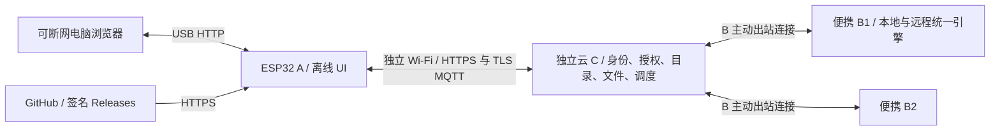

# V3 架构与实现边界

唯一开发规范为 `SPEC_V3.md`。现有项目根目录保持不动，固件仍在 `main/`，避免为了目录样式搬动已工作的 NCM 工程。

- C 不运行模型，不保存权重，所有资源每次检查设备身份、当前配对和归属。配对码与设备凭据不同；别名与 UUID 不同。单对撤销不影响其他关系。
- 本机开发 C 是独立进程/数据根，不能记为独立云部署。当前 HTTPS 权威轮询可实际工作，MQTT 通知与真实 Broker 的验证状态单独记录。
- B 不依赖 C 来运行本地任务。`Engine` 用统一队列、SQLite 和每任务独立子进程执行；Model/Variant/Deployment 元信息与实际环境冻结为任务快照。
- 平台内核不定义 V/I/T、SOC、SOH 或其他领域特征。两个内置 demo 是显式非科研插件：通用表格回归两种 variant、文本/文件统计。
- A 不代理任意 URL，只映射已声明的 C API；JSON 队列和 16 KiB 文件块有上限。客户端收到 202 时仅代表 A 接收，取得 C 持久化回执后才前进。
- A 静态页面、USB、Wi-Fi、C 和 B 状态分别读取；界面不直接访问 C/B，不加载 CDN，不生成假预测。
- 所有公网连接必须验证证书。宿主机不启用共享、网桥、NAT 或转发；不修改用户 Conda/研究环境，不训练用户模型。

## ADR-001：首版服务栈

在已有 Python 3.11 上使用标准库 HTTP(S)、SQLite WAL、进程 worker，避免为原型安装第二套环境。C 为单进程原型，正式多进程扩容时再迁移 PostgreSQL。API 是权威状态；MQTT 只承载小通知，断线后仍以 API 对账。部署脚本不擅自安装 Docker/WSL 或购买云资源。

## ADR-002：网页存储与签名

两个 1 MiB SPIFFS 分区。受控文件包上限 700 KiB，预留文件系统开销；两个 4 MiB app 槽。RSA-2048/SHA-256 签名绑定规范化清单中的目标、序号、版本、兼容性、大小与哈希。私钥只在忽略的本机目录；公开固件仅含公钥，设备管理凭据通过 USB 首次配对存 NVS。资源 asset_set 防止新旧页面资源混用。

## ADR-003：信任边界

worker 是任务与依赖隔离，不是恶意代码安全沙箱。只允许本机管理员导入明确审核的模型代码；远端 A/Agent 不能安装模型或执行 shell。API 和 MCP 保持相同对象权限，不接收任意本地路径作为授权文件。
